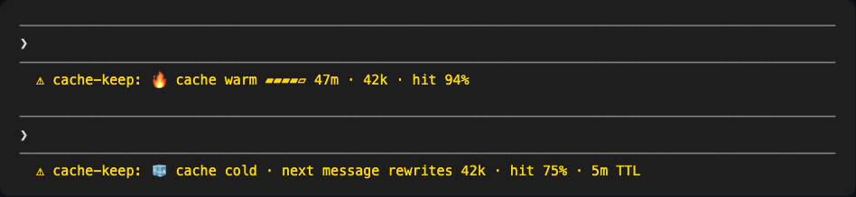
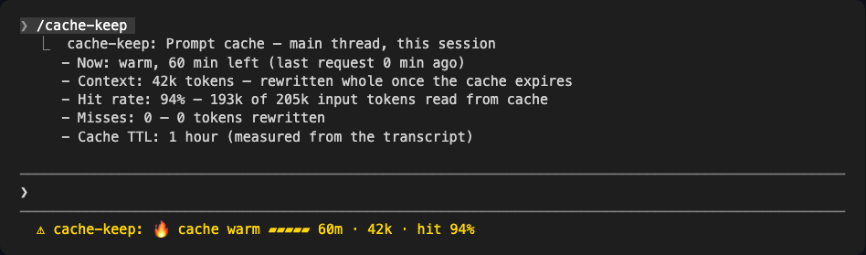
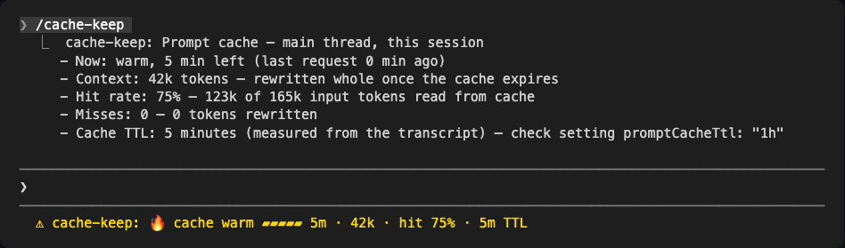

# cache-keep

A Claude Code mod that tells you when your prompt cache **silently dropped to a 5-minute TTL**, with zero model calls and no settings edits. It reads the TTL from the session transcript, and infers it where the transcript can't be read.



- **Status line:** `🔥 cache warm ▰▰▰▰▱ 47m · 312k · hit 94% · 1 miss` while the cache should be alive, `🧊 cache cold · next message rewrites 312k` once it has expired. One bar cell = a fifth of the TTL (12 minutes at 1 hour); the miss count appears after the first miss. Under a measured 5-minute TTL the countdown runs from 5 and the line ends `· 5m TTL`.
- **`/cache-keep`:** a report for the session — time left, context size, hit rate (input tokens read from cache), misses and the tokens they rewrote, and the cache TTL: measured, or inferred when it could not be measured. It answers at once, even mid-turn.
- **Alarm:** one toast per session.
  - **Measured:** after each main turn, cache-keep reads the newest cache write in the transcript (`cache_creation.ephemeral_5m/1h_input_tokens`). A 5-minute write raises *Prompt cache writes are 5-minute — check `promptCacheTtl: "1h"`*. While writes stay 1-hour, the alarm stays quiet.
  - **Inferred:** until the TTL is measured, or wherever the transcript can't be read, a large context rewritten whole after a gap a 1-hour cache should have survived (5–55 min), twice within a rolling hour, raises *5-minute TTL suspected*.

All of it counts the main thread only; subagent writes in the transcript are skipped. A miss is a request that rewrote at least half of a 50k+ context; the first request of a session and the ones right after compaction or a model switch are not counted.





The screenshots are from real Claude Code 2.1.304 terminal sessions: the warm status line and the 1-hour report from a default session, the cold status line and the 5-minute report from one forced with `--settings '{"promptCacheTtl":"5m"}'`.

## Install

At the prompt of a terminal session:

```
/plugin install cache-keep --marketplace maseungsidea/cache-keep
```

From a shell:

```
claude plugin install cache-keep --marketplace maseungsidea/cache-keep
```

Answer `y` to add the marketplace, then pick a scope. In the desktop app: **+ → Plugins → Add marketplace**.

The `language` option (`en` / `ko`) sets the language of the status line, the report and the alarm.

## Why

On a subscription, the main conversation's prompt cache lives for 1 hour. Some accounts have reported it falling to 5 minutes; then every pause longer than 5 minutes rewrites the whole context at write price, and usage climbs without any visible sign. Setting `"promptCacheTtl": "1h"` in `settings.json` fixes that — but only if you know it is happening. cache-keep makes it visible.

## How it compares

Checked against cache mods found via claudemods.dev and GitHub as of 2026-10-22 (cache-clock 0.1.1, cache-tax 2.3.1, cache-warmer, token-optimizer 5.13.57), from their source.

| | cache-keep | cache-clock | cache-tax | cache-warmer | token-optimizer |
|---|---|---|---|---|---|
| Model calls | none | none | keep-warm pings: opt-in, auto-arms 3h after a cold write | keep-warm pings, always on | one per **Keep warm** press, never on a timer |
| Edits your settings | no (`$.ui.status`) | yes, wraps your `statusLine` | no | no | yes, installs its own `statusLine` and restores it each session |
| Blocks a message | no | no | first cold message, once (guard) | no | no |
| Detects a 5-minute TTL drop | yes, measured from the transcript (inferred where it can't be read); the countdown shortens, one alarm toast | no | no (assumes 60 min) | no (configurable, default 60 min) | yes, measured (reads the 5m/1h write split); the countdown shortens, no alarm |
| Reads usage | per API request (`turn.step`), plus the transcript's last 256 KB after each main turn | status-line input | per API request (`turn.step`) | per turn (`turn.complete`) | per API request, plus the transcript via a Python script |
| Shows | time left, context size, hit rate, misses, rewritten tokens; `/cache-keep` report | time left, hit rate, misses, tokens to re-cache | cold-write cost in USD | — | a band above the prompt: cache countdown, context fill, session quality, 5-hour and weekly limits, savings |
| Needs | nothing | nothing | nothing | nothing | Python 3.9+; PolyForm Noncommercial license (work for an employer needs a commercial or small-business license) |

In short: cache-keep is the small one. It does one job, prompt-cache visibility, with no model calls, no settings edits, no runtime beyond Claude Code and an MIT license. Both cache-keep and token-optimizer measure the TTL from the transcript; token-optimizer does far more, but it rewrites your status line and needs Python. cache-clock shows most of the same numbers through your `statusLine`. cache-tax and cache-warmer exist to keep the cache warm, which cache-keep never does.

### Who it's for

- **Your usage jumped and you don't know why.** A common hidden cause is the cache going cold: a 5-minute TTL, or long breaks. The miss count and the alarm show whether it is the cache, and `/cache-keep` gives the numbers to compare with a colleague.
- **You work with a large context** (hundreds of thousands of tokens, or a 1M-context model). One cold rewrite there costs as much as many ordinary turns, so it pays to see the countdown before you step away.
- **You step away often** (meetings, reviews, waiting on a build) and want to know whether to send the next message now or accept a rewrite.
- **You already have a status line you like.** cache-keep adds one entry through the mod API and never touches `settings.json`.
- **You want nothing sent on your behalf:** no pings, no extra usage, no extra process.
- **You set `promptCacheTtl: "1h"` and want to confirm it holds.** `/cache-keep` shows the measured TTL, and the alarm stays quiet while it holds.

### Where it does not fit

- **API-key, cloud or extra-usage sessions** run on a 5-minute TTL by design. There the countdown is right, but the alarm only tells you what you already chose. Use a 1-hour TTL setting, or don't install it.
- Where an organization manages Claude Code, installed plugins don't receive `session.compact` or the `Stop` hook. So the TTL is inferred, never measured, and a rewrite right after compaction can count as a miss and toward the alarm.
- The transcript is read with `tail`, or whole where there is no `tail` (Windows). A read stops at 4 MB, so a large session on Windows falls back to inference.
- If you want the cache kept warm through long breaks, use a keep-warm mod instead; cache-keep only shows and warns.

## Validation

The inferred alarm was replayed over 30 days of real transcripts (497 main-thread sessions). It fired in 6 sessions, all on Claude Code 2.1.280 or older where a prompt-prefix change caused the rewrite; on 2.1.290+ it fired in none.

The measured rule was replayed over the same 30 days (533 transcripts, 397 with the write split). No session mixed 1-hour and 5-minute main-thread writes, so a 1-hour session never raised the measured alarm. It fired in 8 sessions that wrote 5-minute from their first request: 6 SDK runs and 2 of the checks below.

The measured path was checked headless on Claude Code 2.1.304: with the default settings it read a 1-hour write; with `--settings '{"promptCacheTtl":"5m"}'` it read a 5-minute write, shortened the countdown and raised the alarm; with `tail` failing it read the whole file instead. In an interactive terminal session the turn's last request reaches the transcript just after the turn ends, so cache-keep reads it a second later: under a forced 5-minute TTL the status line said `5m TTL` about two seconds after the first reply, and the alarm toast stayed for its 15 seconds.

## License

MIT
